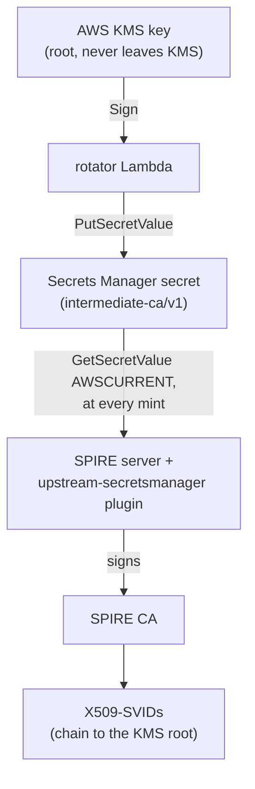

# spire-upstream-secretsmanager

An intermediate CA for [SPIRE](https://spiffe.io/) that lives in AWS Secrets
Manager, is rotated by a Lambda that signs it with a root key held in AWS KMS,
and is read by the SPIRE server **at every mint**. Three components, built,
tested and released together from this repository:

| Component | Directory | What it is | Released as |
| --- | --- | --- | --- |
| **upstream-secretsmanager** | [`upstream-secretsmanager/`](upstream-secretsmanager) · [docs](docs/plugin.md) | A SPIRE UpstreamAuthority plugin that reads its intermediate CA from Secrets Manager at every mint, with a validated local cache. | static binaries (linux/amd64, linux/arm64) and the image `quay.io/palermo/spire-upstream-secretsmanager` |
| **kms-intermediate-rotator** | [`rotator/`](rotator) · [docs](docs/rotator.md) | A Secrets Manager rotation Lambda that issues a name-constrained intermediate CA signed by a KMS key. | `kms-intermediate-rotator_<version>_linux_<arch>.zip` |
| **intermediate-ca/v1** | [`intermediateca/`](intermediateca) · [spec](docs/secret-format.md) | The secret format the two share: a JSON document, its protobuf schema, and the Go package that reads and writes it. | not released on its own: the specification, and the in-repo implementation the rotator and the plugin use |



Each piece works without the others: the plugin reads any secret in the
format (or SPIRE's `awssecret` three-secret layout), the rotator writes one for
any reader, and the format is specified in
[docs/secret-format.md](docs/secret-format.md) for implementations in any
language.

> This repository supersedes
> [bpalermo/kms-intermediate-rotator](https://github.com/bpalermo/kms-intermediate-rotator)
> and
> [bpalermo/intermediate-ca-format](https://github.com/bpalermo/intermediate-ca-format),
> whose code now lives here (`rotator/` and its libraries, `intermediateca/`).
> Those repositories are kept for their history and receive no further
> changes.

## Quick start

1. **The root.** Create an asymmetric `SIGN_VERIFY` KMS key (`ECC_NIST_P384`,
   say) and a self-signed root CA certificate for it, made once with any tool
   that signs through KMS (for example smallstep's `step-kms-plugin`). Give
   the root a path length of at least 2: the intermediate is one CA below it
   and SPIRE's own CA one below that.
2. **The rotator.** Create the secret, deploy the Lambda with the root
   certificate and the secret in its [configuration](docs/rotator.md#rotator-configuration),
   and turn rotation on ([Terraform example](docs/deployment.md#the-rotator-lambda-terraform)).
   The first rotation replaces the placeholder value with an intermediate.
3. **The plugin.** Pin the root (`root_sha256`, the SHA-256 of its DER:
   `openssl x509 -in root.pem -outform DER | sha256sum`) and install the
   plugin in the SPIRE server ([Helm](docs/deployment.md#spire-helm-chart-customplugins),
   [image volume](docs/deployment.md#kubernetes-image-volume) or
   [Docker Compose](docs/deployment.md#docker-compose)), with `secret_id` set to the secret.
4. Every SVID SPIRE mints now chains to the KMS root through the current
   intermediate, and the next rotation is used from SPIRE's next CA rotation
   on, without a restart.

## Documentation

| Document | Contents |
| --- | --- |
| [docs/plugin.md](docs/plugin.md) | The SPIRE plugin: why, configuration, IAM permissions, what it does at each mint, the cache, seeding it for a cold start |
| [docs/rotator.md](docs/rotator.md) | The rotation Lambda: rotation flow, the certificate it issues (name constraints, path length), configuration, recovering a stuck rotation, IAM permissions, logs |
| [docs/secret-format.md](docs/secret-format.md) | The `intermediate-ca/v1` specification, and the Go package that implements it |
| [docs/deployment.md](docs/deployment.md) | Terraform for the Lambda; the plugin with the SPIRE Helm chart, a Kubernetes image volume or Docker Compose |
| [docs/releases.md](docs/releases.md) | What a release publishes and how to verify it with cosign |
| [docs/development.md](docs/development.md) | Building and testing with Bazel, and the repository layout |
| [verifiers/RESULTS.md](verifiers/RESULTS.md) | Which TLS stacks enforce the intermediate's name constraints |

## Build

Everything builds with [Bazel](https://bazel.build); no Go toolchain is needed
on the host.

```bash
bazel build //...
bazel test //...
```

See [docs/development.md](docs/development.md) for the rest.

## License

Apache-2.0, see [LICENSE](LICENSE). The CSR signing (`upstreamca`) and parts
of the plugin are adapted from [SPIRE](https://github.com/spiffe/spire)
v1.15.5, also Apache-2.0, as noted in the source.
