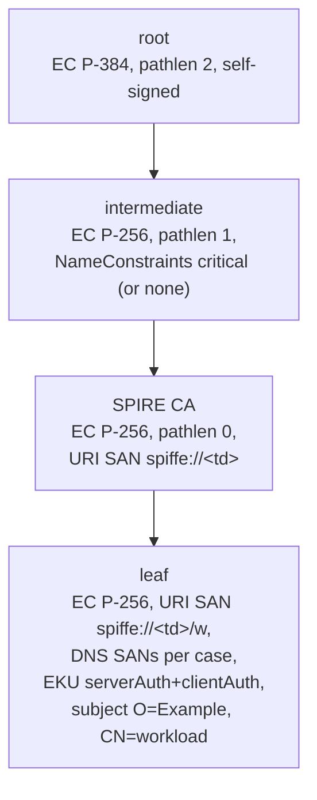

# Verifier results: X.509 name constraints on the intermediate

Phase 0 question: if the intermediate CA that this plugin hands to SPIRE
carries X.509 name constraints, do the verifiers that will see SPIRE's
certificates **enforce** them, and does any of them **reject** a chain only
because the extension is there and critical?

Answer, for every verifier tested: they enforce them, and none rejects a
chain for carrying the extension. Every chain that RFC 5280 accepts was
accepted, and every chain it rejects was rejected, with one exception: Go
reads a URI constraint differently (see [`example.org` vs `.example.org`](#exampleorg-vs-exampleorg)).
The controls (case E: the same leaves with no name constraints) are all
accepted, so every rejection comes from the constraint.

Run on 2026-10-22 with `verifiers/run.sh` (linux/amd64, Docker 29.9.2,
kind v0.31.0). Each test fails when a verdict changes, so a rerun with newer
images shows whether this still holds.

## Chains

Generated by `verifiers/chains` (Go), fresh keys each run:



The peer sends leaf + SPIRE CA + intermediate; the verifier trusts only the
root. The intermediates:

| intermediate | name constraints (critical) |
|---|---|
| `uri` | permitted URI `example.org` |
| `uri-dot` | permitted URI `.example.org` |
| `dns` | permitted DNS `.svc.example.org` (no URI constraint) |
| `excluded` | excluded DNS `.nas.example.org` |
| `none` | none (control) |

## Client certificates (mTLS client auth)

| row | intermediate | SPIRE CA / leaf URI | leaf DNS | RFC 5280 | Go crypto/x509 | Envoy default validator | Envoy SPIFFE validator | MySQL 8.4 | Kafka (JDK PKIX) |
|---|---|---|---|---|---|---|---|---|---|
| **A** | `uri` | `spiffe://example.org/w` | | ACCEPTED | ACCEPTED | ACCEPTED | ACCEPTED | ACCEPTED | ACCEPTED |
| A-dot | `uri-dot` | `spiffe://example.org/w` | | REJECTED | REJECTED | REJECTED | REJECTED | REJECTED | REJECTED |
| A-sub | `uri` | `spiffe://td.example.org/w` | | REJECTED | **ACCEPTED** | REJECTED | REJECTED | REJECTED | REJECTED |
| A-dot-sub | `uri-dot` | `spiffe://td.example.org/w` | | ACCEPTED | ACCEPTED | ACCEPTED | ACCEPTED | ACCEPTED | ACCEPTED |
| **B** | `uri` | `spiffe://other.test/w` | | REJECTED | REJECTED | REJECTED | REJECTED | REJECTED | REJECTED |
| **C1** | `dns` | `spiffe://example.org/w` | `a.svc.example.org` | ACCEPTED | ACCEPTED | ACCEPTED | ACCEPTED | ACCEPTED | ACCEPTED |
| **C2** | `dns` | `spiffe://example.org/w` | `b.other.test` | REJECTED | REJECTED | REJECTED | REJECTED | REJECTED | REJECTED |
| **D1** | `excluded` | `spiffe://example.org/w` | `kafka.nas.example.org` | REJECTED | REJECTED | REJECTED | REJECTED | REJECTED | REJECTED |
| **D2** | `excluded` | `spiffe://example.org/w` | `a.svc.example.org` | ACCEPTED | ACCEPTED | ACCEPTED | ACCEPTED | ACCEPTED | ACCEPTED |
| **E-A** | `none` | `spiffe://example.org/w` | | ACCEPTED | ACCEPTED | ACCEPTED | ACCEPTED | ACCEPTED | ACCEPTED |
| E-sub | `none` | `spiffe://td.example.org/w` | | ACCEPTED | ACCEPTED | ACCEPTED | ACCEPTED | ACCEPTED | ACCEPTED |
| **E-B** | `none` | `spiffe://other.test/w` | | ACCEPTED | ACCEPTED | ACCEPTED | ACCEPTED | ACCEPTED | ACCEPTED |
| **E-C2** | `none` | `spiffe://example.org/w` | `b.other.test` | ACCEPTED | ACCEPTED | ACCEPTED | ACCEPTED | ACCEPTED | ACCEPTED |
| **E-D1** | `none` | `spiffe://example.org/w` | `kafka.nas.example.org` | ACCEPTED | ACCEPTED | ACCEPTED | ACCEPTED | ACCEPTED | ACCEPTED |

Bold rows are the cases asked for (A to E); the others pin down the URI
semantics. The Envoy default validator matches the SAN with a URI prefix
`spiffe://`, and the SPIFFE validator has the root as the bundle of every
trust domain used (`example.org`, `td.example.org`, `other.test`), so only
path validation can reject: case B is rejected by the constraint, not by a
trust-domain mismatch.

## Server certificates (Kafka client checks the broker)

Broker certificates issued under the constrained intermediates (through a
SPIRE CA for `example.org`, URI `spiffe://example.org/kafka`), checked by the
Kafka Java client with hostname verification
(`ssl.endpoint.identification.algorithm=https`, the default) against the name
it dials, which is the certificate's DNS SAN:

| row | intermediate | broker DNS SAN | RFC 5280 | Go crypto/x509 (with `DNSName`) | Kafka client (JDK PKIX + hostname) |
|---|---|---|---|---|---|
| **K-D1** | `excluded` | `kafka.nas.example.org` | REJECTED | REJECTED | REJECTED |
| K-D2 | `excluded` | `kafka.svc.example.org` | ACCEPTED | ACCEPTED | ACCEPTED |
| **K-E** | `none` | `kafka.nas.example.org` | ACCEPTED | ACCEPTED | ACCEPTED |

## Rejection messages

| verifier | row(s) | message |
|---|---|---|
| Go crypto/x509 | A-dot | `x509: a root or intermediate certificate is not authorized to sign for this name: URI "spiffe://example.org/w" is not permitted by any constraint` |
| Go crypto/x509 | B | `... URI "spiffe://other.test/w" is not permitted by any constraint` |
| Go crypto/x509 | C2 | `... DNS name "b.other.test" is not permitted by any constraint` |
| Go crypto/x509 | D1, K-D1 | `... DNS name "kafka.nas.example.org" is excluded by constraint ".nas.example.org"` |
| Envoy (both validators) | A-dot, A-sub, B | `verify cert failed: X509_verify_cert: certificate verification error at depth 1: permitted subtree violation` (depth 1 = the SPIRE CA, whose URI SAN fails first) |
| Envoy (both validators) | C2 | `... at depth 0: permitted subtree violation` |
| Envoy (both validators) | D1 | `... at depth 0: excluded subtree violation` |
| curl, as Envoy's client | all rejections | `curl: (56) OpenSSL SSL_read: OpenSSL/3.5.8: error:0A000416:SSL routines::ssl/tls alert certificate unknown, errno 0` |
| MySQL client | all rejections | `ERROR 2013 (HY000): Lost connection to MySQL server at 'reading authorization packet', system error: 71` (mysqld logs only `[Note] [MY-010914] [Server] Bad handshake`) |
| `openssl verify` of the MySQL image (same OpenSSL 3.5.8) | A-dot, A-sub, B / C2 / D1 | `error 47 at 1 depth lookup: permitted subtree violation` / `error 47 at 0 depth lookup: permitted subtree violation` / `error 48 at 0 depth lookup: excluded subtree violation` |
| Kafka broker (JSSE debug log) | all client rejections | `Fatal (CERTIFICATE_UNKNOWN): PKIX path validation failed: java.security.cert.CertPathValidatorException: name constraints check failed` |
| Kafka client | all client rejections | `SslAuthenticationException: Failed to process post-handshake messages` |
| Kafka client | K-D1 | `CertPathValidatorException: name constraints check failed` |

Envoy's messages are from its connection log (`--component-log-level
connection:debug`). MySQL gives no reason, so its test also runs `openssl
verify -purpose sslclient` with the image's own OpenSSL on the same chain.
Kafka's broker reason is from `-Djavax.net.debug=ssl:handshake`.

## `example.org` vs `.example.org`

RFC 5280 §4.2.1.10: a URI constraint applies to the host of the URI, and
`spiffe://example.org/w` has host `example.org`. A constraint without a
leading period names **one host**; one with a leading period names **the hosts
below** the domain, not the domain itself.

| constraint | `spiffe://example.org/...` | `spiffe://td.example.org/...` |
|---|---|---|
| RFC 5280 `example.org` | ACCEPTED | REJECTED |
| RFC 5280 `.example.org` | REJECTED | ACCEPTED |
| Go crypto/x509 `example.org` | ACCEPTED | **ACCEPTED** (Go treats it as a domain: the host and every host below) |
| Go crypto/x509 `.example.org` | REJECTED | ACCEPTED |
| Envoy (BoringSSL), MySQL (OpenSSL 3.5.8), Kafka (JDK 21) `example.org` | ACCEPTED | REJECTED |
| Envoy, MySQL, Kafka `.example.org` | REJECTED | ACCEPTED |

So, for a trust domain `example.org`, the URI constraint to put on the
intermediate is **`example.org`, without the period**: it is accepted
everywhere. `.example.org` makes every verifier, Go included, reject the SPIRE
CA itself (`spiffe://example.org`). The only disagreement is that Go's
`example.org` also lets through trust domains below it (`td.example.org`),
which OpenSSL, BoringSSL and the JDK refuse; a SPIRE server never asks for
another trust domain, so this matters only as a looser bound in Go-based
verifiers (SPIRE agents, go-spiffe workloads).

## A CA's subject CN and DNS name constraints

Found and bisected on 2026-10-23, outside the harness above: a chain that
`openssl verify` accepts was refused by IAM Roles Anywhere and by the JDK,
because **both check a CA certificate's subject CN against the DNS name
constraints**, not only its subject alternative names.

The failing setup:

- the intermediate has critical name constraints: permitted DNS
  `.example.org` (leading dot: the hosts below `example.org`, not
  `example.org` itself), permitted URI `example.org` and excluded URI
  `.example.org` (exactly the trust domain, see
  [above](#exampleorg-vs-exampleorg));
- the SPIRE CA below it has the subject CN `example.org`, the bare trust
  domain (set with `ca_subject` in SPIRE's `server.conf`), and a URI SAN
  `spiffe://example.org` but no DNS SAN.

| verifier | result |
|---|---|
| IAM Roles Anywhere `CreateSession` (the trust anchor is the root) | `403 AccessDeniedException: Untrusted signing certificate` |
| Java PKIX (Kafka clients) | `CertPathValidatorException: name constraints check failed` |
| `openssl verify` | OK |

The CN `example.org`, read as a DNS name, is not below `.example.org`, so a
verifier that applies DNS constraints to the CN of a certificate without DNS
SANs rejects the SPIRE CA. OpenSSL applies them to the CN of end-entity
certificates only (and only when they have no DNS SAN), so it never looks at
the SPIRE CA's CN. Go's `crypto/x509` applies constraints to SANs alone.

### Bisect

On a throwaway Roles Anywhere trust anchor (a root made for the test). "1
intermediate" is leaf → intermediate → root; "2 intermediates" is leaf →
SPIRE-like CA (CN `example.org` unless the row says otherwise) →
intermediate → root, the production shape.

| intermediate's constraints | 1 intermediate | 2 intermediates |
|---|---|---|
| none | OK | OK |
| DNS + URI | OK | **403** |
| DNS only | OK | **403** |
| URI only | OK | OK |
| DNS + URI, CA CN not the bare domain (`ca.example.org`) | — | OK |
| DNS + URI, CA without a CN | — | OK |
| DNS + URI, DNS permitted as `example.org` (no leading dot) | — | OK |

So the trigger is a DNS constraint that does not cover the CA's CN; the URI
constraints play no part.

### Fixes (any one)

- give the SPIRE CA a CN inside the DNS constraint, for example
  `ca_subject { common_name = "ca.example.org" }` in `server.conf`;
- give it no CN (`ca_subject` without `common_name`);
- permit the DNS domain without the leading dot (`example.org`: the domain
  and every host below it, for every verifier).

[docs/rotator.md](../docs/rotator.md#name-constraints-and-the-spire-cas-cn)
has the warning for whoever configures the constraints.

Not a Bazel verifier: Roles Anywhere needs a real AWS account and cannot be
tested offline, and the Java half would need the chains of `verifiers/chains`
to grow a SPIRE CA with a domain-like CN (today it is `SPIRE CA`, which is not
a DNS name and is skipped, which is why the Kafka rows above do not show it).

## Kubernetes image volume (the plugin's own image)

The plugin image (`//upstream-secretsmanager:image_index`, the binary
alone at `/upstream-secretsmanager`, one `tar+zstd` layer per platform) as an
`image:` volume in a throwaway kind cluster:

| question | answer |
|---|---|
| Cluster | kindest/node v1.36.4, containerd v2.3.4; `ImageVolume` is GA (`kubernetes_feature_enabled{name="ImageVolume",stage=""} 1`), nothing to enable |
| Image reaches containerd as built? | yes: OCI layout tarball imported with `ctr -n k8s.io images import --all-platforms`; both layers `application/vnd.oci.image.layer.v1.tar+zstd` |
| Mounts? zstd OK? | yes, containerd unpacks the zstd layer; mounted as overlay with `ro,relatime,...` |
| Exec allowed? | yes, not `noexec`: `/plugin/upstream-secretsmanager --version` prints `upstream-secretsmanager <version>`, as a container command (root and `runAsUser: 65532`) and through `kubectl exec` |
| `subPath` | directory subPath works (`subPath: .`, exec from it too). **File subPath fails**: `CreateContainerError: failed to mount image volume: ImageVolumeMountFailed: failed to ensure image subpath "upstream-secretsmanager" in "...": only directory subpath is supported`. Mount the whole volume (e.g. at `/plugin`) and point SPIRE's `plugin_cmd` at `/plugin/upstream-secretsmanager` |
| CRI-O | not tested: kind nodes run containerd only |

## Versions

| component | version | image (multi-platform index digest) |
|---|---|---|
| Go crypto/x509 | Go 1.27.2 (go.mod) | — (runs in normal CI) |
| Envoy | v1.39.4 (BoringSSL) | `envoyproxy/envoy:v1.39.4@sha256:74bd4eb5629708d3fadca1a5e6b85d208f338d7bb54e06b69565905c5294cc01` |
| curl (Envoy's client) | 8.22.0, OpenSSL 3.5.8 | `curlimages/curl:8.22.0@sha256:58adaa4e8dca9c988bae2aba4ab3434a0bb2da16bbe3f92dec39ec7785166777` |
| MySQL | 8.4.13, openssl-libs-3.5.8-2.0.1.el9_8 | `mysql:8.4.13@sha256:76f0358884cb92d9a086d24e5671c38048d3fef40f2588703d73eb55392d6b69` |
| Kafka | 4.3.1 KRaft, Temurin 21.0.11+10 | `apache/kafka:4.3.1@sha256:77e3df9054047a88b520d0cc46e16696d3b22022e1d580aeccd2632df6532837` |
| kind node | Kubernetes v1.36.4, containerd v2.3.4 | `kindest/node:v1.36.4@sha256:099e049362a1526b2db71494e1947aae99bd16290d7c895f2b7ea312e3cbfaed` |
| busybox (image volume pod) | 1.37.0 | `busybox:1.37.0@sha256:bdf57e528e45e4433820e045b29b4597825a1c9e38353532d90a01445013f82e` |

## Running

```bash
verifiers/run.sh                                # everything
verifiers/run.sh //verifiers/kafka:kafka_test   # one
bazel test //verifiers/gox509:gox509_test       # the only one in CI
```

| target | what it drives | time |
|---|---|---|
| `//verifiers/gox509:gox509_test` | Go crypto/x509, in process | < 1 s |
| `//verifiers/envoy:envoy_test` | an Envoy container, curl containers | ~25 s |
| `//verifiers/mysql:mysql_test` | a MySQL container | ~20 s |
| `//verifiers/kafka:kafka_test` | KRaft broker containers, Java client containers | ~90 s |
| `//verifiers/imagevolume:imagevolume_test` | a kind cluster | ~45 s |

All but the first are tagged `manual`, `requires-docker`, `exclusive`, `local`
and `external` (`verifiers/defs.bzl`): `bazel test //...` and CI skip them, and
a run is never cached. They need a local Docker daemon and, for the image
volume test, `kind` on PATH. Networks, containers and the cluster are named
`susm-*` and removed when their test ends; `run.sh` reports any left behind.
Rows also land as TSV in `bazel-testlogs/verifiers/<pkg>/<pkg>_test/test.outputs/`.
AWS IAM Roles Anywhere is out of scope here: it needs a real AWS account
(see [A CA's subject CN and DNS name constraints](#a-cas-subject-cn-and-dns-name-constraints)
for what was found by hand).
